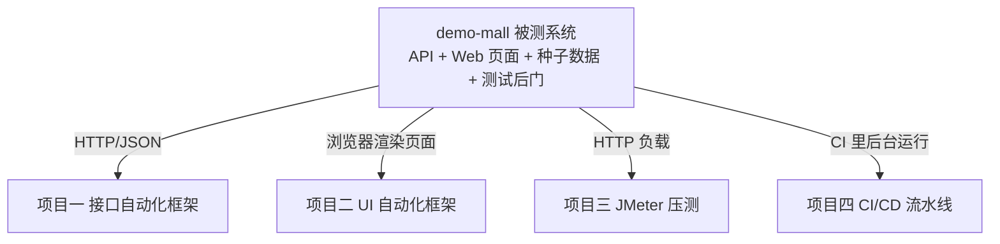

# demo-mall · 被测系统设计说明（文档01）

> 一句话：为什么这个商城长这样——它不是随便写的小网站，而是为"练习测试工程"定制的靶场。

## 1. 它在整个课程中的位置



## 2. 涉及文件

| 文件 | 职责 |
|---|---|
| `config.py` | 端口/JWT/测试钥匙/DB 路径 |
| `app/schema.sql` | 5 张表：users/goods/cart_items/orders/order_items |
| `app/db.py` | SQLite 连接管理（g 对象按请求复用） |
| `app/errors.py` | 统一响应封装 + 业务错误码字典 |
| `app/auth.py` | JWT 签发/校验/吊销 + pbkdf2 密码摘要 |
| `app/api/*.py` | 5 个蓝图：auth/goods/cart/order/test |
| `app/web/views.py` + `templates/` | 服务端渲染页面（UI 自动化的靶子） |
| `seed.py` | 种子数据 + 一键重置 |
| `run.py` | dev（Flask）/ prod（waitress）两种启动模式 |

## 3. 关键设计逐条讲解（每条都是"为什么"）

### 3.1 响应包裹 `{"code":0,"message":"ok","data":{...}}`

国内互联网的主流约定：**HTTP 状态码只管传输层，业务成败看 body.code**。
这就是接口框架"三层断言"存在的根本原因（见项目一 docs/07）。
例外：鉴权失败返回 HTTP 401 + code 4010——因为它发生在进入业务之前。

### 3.2 JWT + jti 吊销名单

```python
payload = {"user_id", "username", "jti": uuid4().hex, "exp", "iat"}
```

- `exp`（30 分钟）让"token 过期"真实存在；
- `jti` + 内存黑名单让"主动吊销"真实存在 → 项目一才能写出
  「吊销→401→自动重登→重放」这条链路用例；
- 教学点：JWT 天然无状态不可主动失效，所以真实系统用"短过期+刷新 token"或黑名单。

### 3.3 测试后门 `/api/test/*`（X-Test-Key 鉴权）

- `POST /api/test/reset`：数据库一键回种子状态——**自动化可重复的基石**，
  项目一/二的 conftest 都在套件开始时调它；
- `POST /api/test/revoke-token`：制造真实 401。
- 企业对应物：测试环境管理平台/影子库。教学版简化为固定钥匙 `mall-test-key`。

### 3.4 确定性种子数据

`seed.py`：2 个账号 + 10 件商品（id 1-10，价格库存固定），
`reset` 时连 `sqlite_sequence` 都清掉（自增 id 复位）——
**价格 199.0、库存 100、新用户 id=3 这些精确值才能被写进断言**。
改动种子必须同步改项目一的 data/*.yaml（双向契约）。

### 3.5 订单状态机与事务

- 状态机：`pending → paid`（支付）/ `pending → cancelled`（取消，回补库存）；
  非法流转返回 4002——UI/接口层"重复支付""已支付再取消"用例的靶子；
- 下单在**一个事务**里：扣库存+建订单+建明细+清购物车，失败整体回滚——
  讲"接口测试要不要测事务一致性"的现成例子。

### 3.6 页面元素的"可测性埋点"

所有可交互元素带稳定 id（`#username` `#btn-add-cart` `#flash`...），
状态提示统一进 `#flash`。真实项目里这是 QA 推动前端做的"可测性改造"——
**UI 自动化做不做得起来，一半取决于被测页面给不给稳定的定位器**（项目二 docs/04 详述）。

### 3.7 两种启动模式（给性能测试留的伏笔）

- `python run.py`：Flask 内置服务器（threaded=True，开发用）；
- `python run.py --mode prod`：waitress 8 线程（生产级 WSGI）。
项目三压测两种模式的 TPS 对比 = 一个真实的"发现瓶颈→给出优化建议→验证优化效果"故事。

### 3.8 SQLite 而不是 MySQL

零安装零配置，clone 即跑；表结构/SQL 与 MySQL 几乎同构，
切换只动 `app/db.py`（README 写了怎么切）。**被测系统的复杂性是成本，
简单到人人能跑起来才是它的第一使命。**

## 4. 接口清单（自动化视角）

| 方法 路径 | 鉴权 | 成功 data | 失败业务码 |
|---|---|---|---|
| GET /api/health | 无 | status | - |
| POST /api/auth/register | 无 | user_id/username | 1003 重名、1004 参数 |
| POST /api/auth/login | 无 | token/expires_in/user | 1001、1002、1004 |
| GET /api/auth/me | Bearer | user | 4010 |
| GET /api/goods | 无 | list/total/page/page_size | 1004 |
| GET /api/goods/{id} | 无 | 商品详情 | 2001 |
| GET /api/cart | Bearer | items/total_amount/count | 4010 |
| POST /api/cart/items | Bearer | goods_id/quantity | 2001、2002、1004 |
| PUT /api/cart/items/{id} | Bearer | item_id/quantity | 3002、2002、1004 |
| DELETE /api/cart/items/{id} | Bearer | item_id | 3002 |
| POST /api/orders | Bearer | order_id/order_no/total_amount/status | 3001、2001、2002、1004 |
| GET /api/orders | Bearer | list/total | - |
| GET /api/orders/{id} | Bearer | 订单+明细 | 4001 |
| POST /api/orders/{id}/pay | Bearer | status=paid | 4001、4002 |
| POST /api/orders/{id}/cancel | Bearer | status=cancelled | 4001、4002 |
| POST /api/test/reset | X-Test-Key | reset=true | 403 |
| POST /api/test/revoke-token | X-Test-Key | revoked=true | 403、1004 |

## 5. 怎么运行/验证

```bash
cd D:\软件测试\demo-mall
pip install -r requirements.txt
python seed.py --reset
python run.py               # http://127.0.0.1:5000
```

冒烟五连（PowerShell/requests 任选）：

```bash
curl http://127.0.0.1:5000/api/health
curl -X POST http://127.0.0.1:5000/api/auth/login -H "Content-Type: application/json" -d "{\"username\":\"lemon\",\"password\":\"123456\"}"
curl -X POST http://127.0.0.1:5000/api/test/reset -H "X-Test-Key: mall-test-key"
```

浏览器打开 http://127.0.0.1:5000/goods 用 lemon/123456 登录走一遍购物流程。

> 注意：Git Bash 的 curl 直接在 URL 里写中文会编码错乱（项目一 docs/07 坑 2），
> 验证中文搜索用 Python requests 或 Postman。

## 6. 常见坑

1. **Flask session 报 RuntimeError: no secret key**——`app.secret_key` 忘了设（本仓库已修，复现时容易忘）。
2. **改了代码不生效**：dev 模式关了 debug 自动重载，改完要重启 `run.py`。
3. **数据库文件锁**：两个终端同时跑两个 mall 实例用同一个 db 文件，SQLite 并发写会锁——多实例时用 `--port` 区分，数据目录共享没问题但压测时注意。
4. **中文参数在 curl 里"搜不到"**：是 curl/终端编码问题，不是服务端 bug（用 requests 验证）。

## 7. 面试怎么讲（作为"我搭了被测系统"的加分项）

**30 秒版**：
"为了让测试框架零依赖可复现，我用 Flask+SQLite 写了一个轻量商城作为被测系统：
统一 code/HTTP 双层响应约定、JWT 带 jti 吊销、订单状态机和事务、
确定性种子数据、以及 reset/revoke 两个测试辅助接口——
这些设计直接决定了自动化框架能做到什么程度：
数据可重置才可重复，token 可吊销才能测自动重登，页面埋了稳定 id 才能做 UI 自动化。"

**高频追问**：
1. *"为什么自己写被测系统而不直接测开源项目？"* —— 可复现（面试官/HR 环境一键跑）+ 可控（能制造 token 吊销这类真实系统不敢开的场景）；同时保留了"分层框架指向真实系统只改 api 层"的演进路径。
2. *"它和真实电商差在哪？"* —— 没有支付网关/分布式/高并发设计；但鉴权、状态机、事务边界、库存一致性的测试要点都在。

## 8. 复现任务清单

- [ ] 1. 独立从零写出 schema.sql 五张表（画 ER 图）
- [ ] 2. 实现统一响应封装 ok()/fail() 和错误码字典
- [ ] 3. 实现 JWT 签发/校验/jti 吊销（用 jwt.io 解析一次自己的 token）
- [ ] 4. 实现 /api/test/reset（含 sqlite_sequence 清理——想想为什么必须）
- [ ] 5. 手工走通：登录→加购→下单→支付→取消→库存回补（curl 或 Postman）
- [ ] 6. 复现"secret_key 未设置"的报错并修复——记住这个坑
